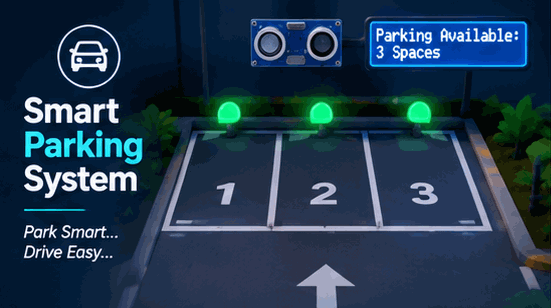
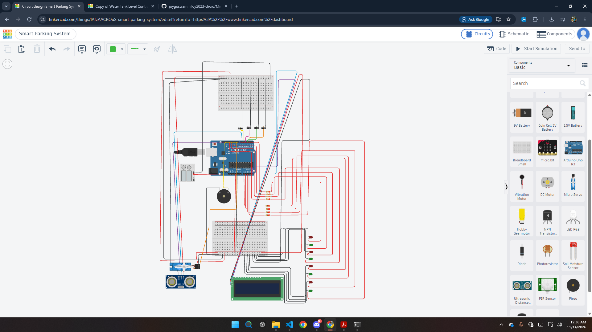

<div align="center">

# 🚗 Smart Parking System

### An Arduino-powered prototype for smarter parking-space monitoring

<p>
  
  
  
  
</p>



**Park Smart. Drive Easy.**

</div>

---

## 📖 About the Project

The **Smart Parking System** is an Arduino-based embedded-systems project that demonstrates how parking spaces can be monitored with sensors and communicated through visual and audio indicators.

An ultrasonic distance sensor measures the distance to an object in the monitored area. The Arduino Uno processes the sensor readings and controls the connected output components. LEDs provide visual status indications, an LCD displays parking-related information, and a buzzer can provide an audible alert when a programmed condition is met.

The circuit shown in this repository was designed in **Tinkercad Circuits**.

> **Project scope:** This repository documents the hardware prototype shown in the circuit diagram. The animated parking GIF is a visual illustration for the README, not a recording of the live Tinkercad simulation.

## ✨ Features

- 📡 **Ultrasonic vehicle detection** — measures distance to help detect a vehicle in the monitored area.
- 🚦 **LED status indicators** — provides visual feedback for parking status.
- 🖥️ **LCD information display** — displays parking-related messages or availability information, depending on the uploaded sketch.
- 🔔 **Buzzer notification** — supports audible alerts when configured in the Arduino code.
- ⚙️ **Automatic control** — Arduino processes sensor readings and updates connected outputs.
- 🧪 **Circuit simulation** — the hardware layout can be tested and demonstrated in Tinkercad.

## 🧰 Hardware Components

| Component | Purpose |
|---|---|
| Arduino Uno R3 | Main microcontroller; reads inputs and controls outputs |
| Ultrasonic distance sensor (HC-SR04-style) | Measures distance in the monitored parking area |
| LCD module | Displays parking information and system messages |
| LEDs | Provides visual status indication |
| Buzzer | Produces an audible notification |
| Resistors | Limits current for components where required |
| Breadboards | Provides a prototyping platform for connections |
| Jumper wires | Connects the modules and components |

*The component list is based on the visible circuit design. Confirm exact module models and quantities against your final physical build.*

## 🧠 How It Works

1. **Distance measurement:** The ultrasonic sensor sends a signal and measures the time taken for its echo to return.
2. **Data processing:** The Arduino reads the sensor measurement and evaluates it using the threshold defined in the program.
3. **Status decision:** The program determines the appropriate parking indication based on the sensor reading and configured logic.
4. **Visual feedback:** LEDs indicate the current status of the monitored area or parking positions.
5. **LCD update:** The display presents the parking message or availability information programmed in the sketch.
6. **Audio alert:** The buzzer sounds when the program's alert condition is triggered.

The exact detection threshold, number of monitored spaces, LED mapping, and LCD messages are determined by the Arduino source code.

## 🔌 Circuit Diagram

The following image shows the Tinkercad circuit layout used for this project.

<div align="center">
  
  <p><em>Smart Parking System — Tinkercad circuit design</em></p>
</div>

### Main circuit modules

- Arduino Uno R3 — central controller
- Ultrasonic sensor — distance input
- LCD — text output
- LEDs — visual indicators
- Buzzer — audio output

> **Wiring note:** Exact pin assignments are intentionally not listed here because they should match the final `.ino` sketch. Add a pin-mapping table after confirming the connections in your code.

## 💻 Software & Tools

| Tool / Technology | Usage |
|---|---|
| Arduino C/C++ | Microcontroller programming |
| Arduino IDE | Writing, compiling, and uploading the sketch |
| Tinkercad Circuits | Circuit design and simulation |
| Embedded systems | Sensor input and hardware control |

## 🚀 Getting Started

### 1. Open the project

Clone this repository:

```bash
git clone https://github.com/<your-username>/Smart-Parking-System.git
cd Smart-Parking-System
```

Replace `<your-username>` with your GitHub username.

### 2. Open the Arduino sketch

Open the project's `.ino` file in the Arduino IDE. If the source code has not yet been added, place your final sketch in the `src/` directory and update the filename below.

### 3. Select the board

In Arduino IDE, select:

- **Board:** Arduino Uno
- **Port:** The port connected to your Arduino (for a physical board)

For a Tinkercad simulation, open the circuit and use its built-in Code and Start Simulation controls.

### 4. Verify and run

Compile the sketch, resolve any reported errors, and start the simulation or upload it to the Arduino Uno. Check that the sensor readings, LCD messages, LEDs, and buzzer behave as expected.

## 📂 Repository Structure

```text
Smart-Parking-System/
│
├── README.md
├── assets/
│   ├── parking-demo.gif
│   └── circuit-diagram.png
│
└── src/
    └── smart_parking_system.ino
```

Add your actual Arduino `.ino` file to `src/`. If your source file has a different name, update the structure above to match it.

## 🎯 Project Objectives

- Explore sensor-based vehicle detection.
- Demonstrate how a microcontroller can process sensor input.
- Communicate system status through an LCD and LEDs.
- Use an audible alert as an additional feedback method.
- Apply embedded-systems concepts to a practical parking-management scenario.

## 🔭 Future Improvements

- Add an individual sensor for each parking bay to monitor multiple spaces independently.
- Connect the Arduino to an IoT platform for remote status monitoring.
- Build a mobile application or web dashboard for live parking availability.
- Add automated slot allocation and entry/exit management.
- Store parking activity and usage statistics.
- Explore online reservation and payment integration.

## ⚠️ Notes & Limitations

- Detection accuracy depends on sensor placement, distance thresholds, and the surrounding environment.
- A single sensor can only monitor the area covered by its placement; multiple independent bays generally require separate sensing or another suitable detection arrangement.
- The README's GIF is illustrative. Use a screen recording of the actual simulation if you want to demonstrate the real circuit behavior.
- Update the component list, pin mapping, and operating instructions if the final hardware or code differs from the circuit shown.

## 🤝 Contributing

Suggestions and improvements are welcome. To contribute:

1. Fork the repository.
2. Create a feature branch: `git checkout -b feature/your-feature`.
3. Commit your changes: `git commit -m "Add your feature"`.
4. Push the branch: `git push origin feature/your-feature`.
5. Open a pull request.

## 📄 License

No license has been specified yet. If you want others to use, modify, and distribute this project, add a license file (for example, an MIT License) and update this section accordingly.

---

<div align="center">

**Built with Arduino · Designed in Tinkercad**

If this project helped or inspired you, consider giving the repository a ⭐.

</div>
